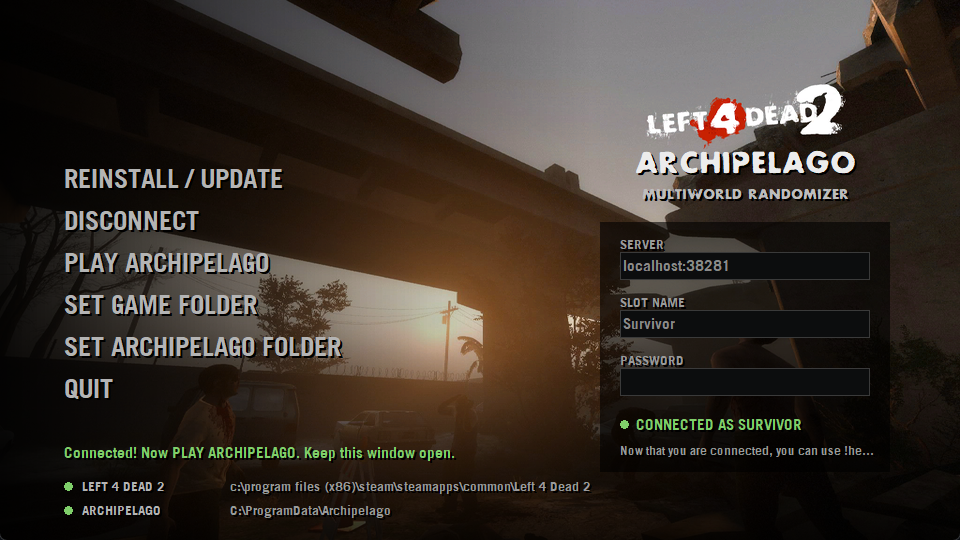
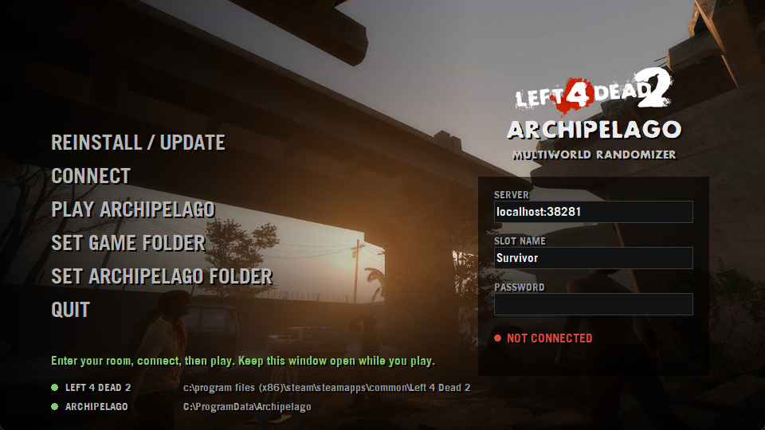
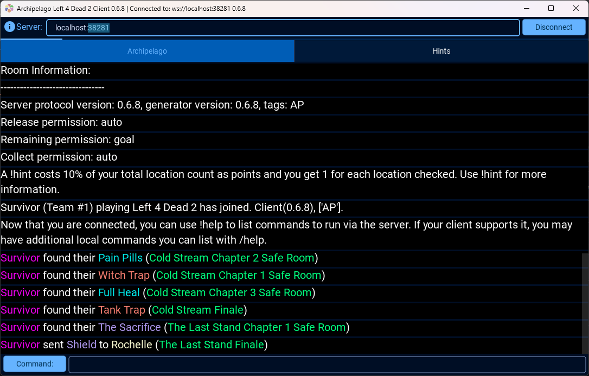
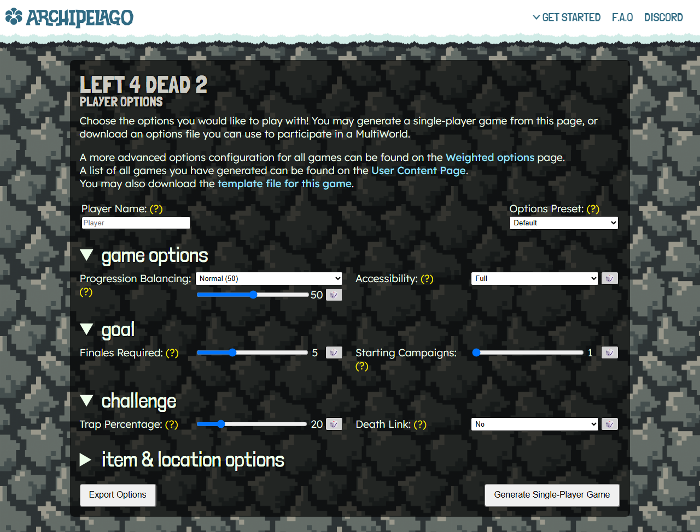
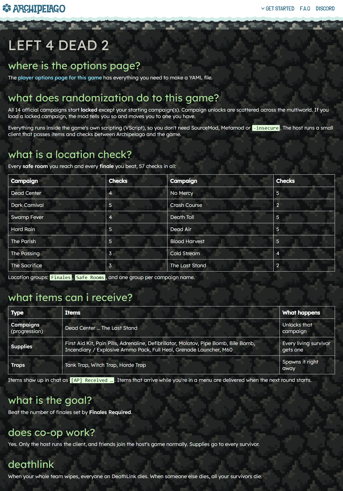

<div align="center">

# Left 4 Dead 2 — Archipelago

**A multiworld randomizer for Left 4 Dead 2.** Campaigns unlock as items, every safe room and finale is a check,
and Tanks can come from your friends' worlds.

No SourceMod. No Metamod. No `-insecure`. One installer.



</div>

## Features

- **57 checks**: every chapter's safe room and every finale across all 14 official campaigns
- **Locked campaigns**: start with one (or more), and the rest are scattered across the multiworld
- **Supplies for the whole team**: medkits, pills, adrenaline, defibs, throwables, ammo packs, full heals,
  Grenade Launchers and M60s
- **Traps**: a Tank, a Witch or a horde, spawned the moment it arrives
- **DeathLink** (optional): a team wipe takes everyone down with you
- **Co-op**: only the host runs the client, and friends join normally
- **One-click launcher**: installs the mod, connects to your room in the background and launches the game. It's
  styled with the menu art, fonts and sounds from your own copy of L4D2.

## Install

1. Install [Archipelago](https://github.com/ArchipelagoMW/Archipelago/releases) **0.6.4 or newer**.
2. Download **`L4D2 Archipelago Installer.exe`** from the [latest release](../../releases/latest).
3. Run it and click **INSTALL**. It finds Left 4 Dead 2 and Archipelago for you.

<details>
<summary>Manual install</summary>

- Copy `l4d2.apworld` into `Archipelago/custom_worlds/`.
- Copy `archipelago.vpk` into `Left 4 Dead 2/left4dead2/addons/`.
- In Archipelago's `host.yaml`, set:
  ```yaml
  l4d2_options:
    game_folder: "C:/Program Files (x86)/Steam/steamapps/common/Left 4 Dead 2"
  ```

</details>

## Play

1. Make your YAML from [`examples/Left 4 Dead 2.yaml`](examples/Left%204%20Dead%202.yaml) or the options page,
   then generate and host as usual.
2. In the launcher, enter the **server**, your **slot name** and the **password** (if any), then click **CONNECT**.
   The client runs hidden in the background. Keep the launcher open while you play.
3. Click **PLAY ARCHIPELAGO**. If your first campaign is locked, the mod moves you to one you have.
4. Chat shows `[AP] Connected to the Archipelago client.` and items appear as `[AP] Received …`.

Prefer the standard Archipelago client? Open the Archipelago Launcher → **Left 4 Dead 2 Client** instead of
clicking Connect.

| Launcher | Archipelago client |
|---|---|
|  |  |

## Options



| Option | Default | |
|---|---|---|
| `finales_required` | 5 | Finales to beat to goal (1–14) |
| `starting_campaigns` | 1 | Campaigns unlocked at the start (1–14) |
| `trap_percentage` | 20 | Percent of filler that are Tank / Witch / Horde traps |
| `death_link` | false | Share deaths with the multiworld |

Presets: **Quick Run** (2 finales, 2 starting campaigns) and **Full Apocalypse** (all 14 finales, 40% traps,
DeathLink).

<details>
<summary>Game info page (as shown on the Archipelago website)</summary>



</details>

## How it works

Left 4 Dead 2's scripting language (VScript) can't open network connections, but it can read and write files in
`left4dead2/ems/`. So the mod is a scripted mutation, and the client handles the server and swaps two small text
files with the game:

| File | Direction | Contents |
|---|---|---|
| `ems/archipelago/in.txt` | client → game | seed, unlocked campaigns, pending items, incoming DeathLink |
| `ems/archipelago/out.txt` | game → client | seed, last item applied, wipe count, checked maps |

The client writes `in.txt` atomically, and both files end with an `end` line, so a half-written file is ignored.

## Project layout

| Path | What |
|---|---|
| [`apworld/l4d2/`](apworld/l4d2) | The Archipelago world: items, locations, options, rules, client, tests, docs |
| [`addon/`](addon) | Contents of `archipelago.vpk`: the mutation and its VScript |
| [`installer/`](installer) | The launcher/installer. It reads the menu art (VTF), fonts (vfont) and sounds from your L4D2 install at runtime, so no game files are redistributed |
| [`tools/build.py`](tools/build.py) | Builds everything into `dist/` |

## Build from source

```bash
pip install vpk pyinstaller pillow
python tools/build.py
```

The output goes to `dist/`: `l4d2.apworld`, `archipelago.vpk`, and `L4D2 Archipelago Installer.exe` (which has
the other two bundled inside).

**Tests:** copy `apworld/l4d2` into an Archipelago source checkout's `worlds/` folder and run
`python -m pytest worlds/l4d2`.

## Status

Early alpha (v0.1.0). Generation, the Archipelago tests and the client ↔ file bridge are tested. The in-game
script is new, so please [report anything odd](../../issues) along with what chat showed and what's in
`left4dead2/ems/archipelago/`.

## Credits

- [Archipelago](https://archipelago.gg)
- The vfont decoding is ported from [ValveResourceFormat](https://github.com/ValveResourceFormat/ValveResourceFormat)
- Inspired by the earlier [SourceMod-based L4D2 Archipelago](https://github.com/Syoshiii/Left4Dead2-Archipelago)

Left 4 Dead 2 is a trademark of Valve Corporation. This is an unofficial fan project, not affiliated with Valve.
